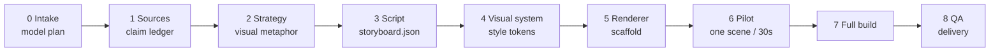

<div align="center">

# claim-to-frame

**An agent skill for turning source material into diagrams, interactive pages, and short explainer videos.**

[English](README.md) · [简体中文](README.zh-CN.md)

[](https://github.com/Temp0jd/claim-to-frame/actions/workflows/validate.yml)
[](LICENSE)
[](CHANGELOG.md)
[](https://www.npmjs.com/package/@tempo1221/claim-to-frame)
[](SKILL.md)

</div>

---

## Why I built this

When I asked coding assistants to explain a complex system or paper, I kept getting the same thing: a lot of prose, very little evidence or structure. The answer sounded fluent, but I could not tell whether it was accurate or just confident. I built this skill so that every factual claim has a source anchor, and so the explanation uses the medium the idea actually needs instead of defaulting to text.

## What it is

claim-to-frame is an Agent Skill for coding agents such as Claude Code, Cursor, or Codex. Instead of writing a summary from memory, the skill takes an agent through a staged pipeline and produces a checked explanation: a structured answer, a diagram, an offline HTML explainer, or a timed Manim/HyperFrames video.

The repository root contains `SKILL.md`, which agent runtimes load directly. The main handoffs have file contracts (`project.json`, `storyboard.json`, `render_manifest.json`, `qa_report.json`). Small Python scripts validate the JSON files and media.

## Installation

Install as an agent skill from GitHub:

```bash
npx skills add Temp0jd/claim-to-frame -g -y
```

Or install as an agent skill from the published npm tarball:

```bash
npx skills add https://registry.npmjs.org/@tempo1221/claim-to-frame/-/claim-to-frame-0.2.0.tgz -g -y
```

Install the npm package itself (scripts, schemas, references, and examples):

```bash
npm install @tempo1221/claim-to-frame
```

Or clone the repository and copy it into your agent skills path:

```bash
git clone https://github.com/Temp0jd/claim-to-frame.git
mkdir -p ~/.claude/skills
cp -r claim-to-frame ~/.claude/skills/claim-to-frame
```


**Requirements:** Python 3.10+ for contracts and scripts. Video QA needs FFmpeg/FFprobe. HyperFrames needs Node 22+ and Chrome.

## Quick start

```bash
# 1. Scaffold a project workspace
python3 scripts/scaffold.py \
  --mode forward --artifact video --renderer hyperframes \
  --title "Why caches help" --language en --out ./explainers/caches

# 2. Record providers and models in project.json, then prepare sources.md and storyboard.json

# 3. Validate contracts and check model configuration
python3 scripts/validate_project.py ./explainers/caches/project.json
python3 scripts/validate_storyboard.py ./explainers/caches/storyboard.json
python3 scripts/preflight_model.py ./explainers/caches/project.json --registry assets/model-registry.example.json

# 4. Render a single-scene pilot (silent; pass --require-audio for the final mux)
scripts/render_hyperframes.sh ./explainers/caches/render/hyperframes ./explainers/caches/render/out.mp4
python3 scripts/qa_video.py ./explainers/caches/render/out.mp4 --project caches \
  --storyboard ./explainers/caches/storyboard.json
```

## How it works

The workflow has nine stages. Each stage has a gate, and the JSON contracts are checked by scripts. If a gate fails, the pipeline stops before spending more time or tokens.



Detailed entrance and exit criteria are documented in [`docs/pipeline.md`](docs/pipeline.md).

## Modes and artifacts

The skill operates in three modes:
- `forward`: explain a concept, paper, architecture, or policy from scratch.
- `reverse`: analyze an existing video into evidence-backed shots and structured storyboard data to inspect or rebuild it.
- `hybrid`: borrow the narrative pacing and visual structure of a reference explainer while supplying new claims and assets.

### The artifact ladder

Pick the lowest sufficient rung that satisfies the reader’s need:

| Artifact | Rung | Best when |
| --- | --- | --- |
| `answer` | 0 | Small, familiar, factual questions |
| `ste` | 1 | Standardized procedures, compliance rules, terminology, and audits |
| `diagram` | 2 | Static system architectures, hierarchies, sequence flows, and state machines |
| `html` | 3 | Dynamic mechanisms with interactive variables, sliders, or state exploration |
| `video` | 4 | Mathematical derivations, dynamic systems, and intuition over time |
| `knowledge-film` | 4 | 2–5 minute visual-first explainers (16:9 format, subtitle-led, tight rhythm) |

The scaffold creates the first set of files:

```text
explainers/caches/
├── README.md
├── project.json
├── sources.md
├── storyboard.md
├── storyboard.json
├── qa/
└── render/
    └── hyperframes/
        ├── index.html
        └── compositions/scene.html
```

`render_manifest.json` and `qa_report.json` are written after rendering and QA.

## Swappable model roles

The workflow separates process logic from model choice. At intake, the agent prompts for provider and model assignments across four operational roles:

- `analysis`: extracts claims, formulas, and transcripts from source documents or video.
- `storyboard`: writes the narrative arc, visual metaphors, and shot actions.
- `implementation`: generates renderer code (GSAP, Manim, Canvas) and runs builds.
- `review`: audits factual fidelity, visual clarity, contrast, and timing.

Model choices are explicitly saved in `project.json`:

```json
{
  "models": {
    "analysis":       { "status": "selected", "provider": "command-code", "model": "deepseek/deepseek-v4.1-flash", "selected_by": "user" },
    "storyboard":     { "status": "selected", "provider": "command-code", "model": "deepseek/deepseek-v4.1-flash", "selected_by": "user" },
    "implementation": { "status": "selected", "provider": "command-code", "model": "deepseek/deepseek-v4.1-flash", "selected_by": "user" },
    "review":         { "status": "selected", "provider": "command-code", "model": "deepseek/deepseek-v4.1-flash", "selected_by": "user" }
  }
}
```

No model is inferred from a provider name; both are recorded. Mid-project model changes must be logged to `model_history` rather than swapped silently. Before rendering, `scripts/preflight_model.py` checks declared capabilities. See [`docs/model-selection.md`](docs/model-selection.md).

## Renderers

Renderers are swappable backends that share `style_tokens` in `storyboard.json`:

| Renderer | Best suited for |
| --- | --- |
| `hyperframes` | HTML/CSS/GSAP, typography, UI widgets, code blocks, and 2D layouts |
| `manim` | Mathematical formulas, coordinate systems, geometry, and 3D scenes |
| `remotion` | React-based animations and video compositions |
| `canvas` | Custom frame-by-frame 2D animation |
| `static` | Standalone SVG/PNG diagrams, schematics, and flowcharts |

Renderers can be mixed: for example, Manim for mathematical derivations and HyperFrames for title and recap cards. See [`references/renderers.md`](references/renderers.md).

## Worked example: Transformer explainer

The repository includes a 107.9-second Chinese explainer on Transformer and self-attention, rendered at 1920×1080 and 30 fps with HyperFrames, Chinese narration, and soft subtitles.

<p align="center">
  <a href="examples/transformer/">
    
  </a>
</p>

<p align="center">
  <a href="examples/transformer/"><strong>View the Transformer explainer files →</strong></a>
</p>

The example demonstrates:
- Grounded citations in `sources.md` linking claims directly to Vaswani et al. (2017).
- Monotonic shot timings and visual action specifications in `storyboard.json`.
- Programmatic HTML/CSS/GSAP animation code in `compositions/scene.html`.
- QA results in `qa_report.json` for contrast (109/109 text checks pass WCAG AA), layout, runtime, decode, and captions.

## Quality checks and scripts

Deterministic scripts verify contracts and media files across stages:

- `scripts/validate_project.py`: checks `project.json` against its JSON Schema and validates stage statuses.
- `scripts/validate_storyboard.py`: verifies monotonic scene timings and required visual actions in `storyboard.json`.
- `scripts/preflight_model.py`: verifies provider, model, and capabilities (vision, shell, code) in `project.json`.
- `scripts/qa_video.py`: inspects rendered MP4 files for codecs, decode errors, black frames, loudness, and subtitle timing.
- `scripts/retime_storyboard.py`: reconciles storyboard scene durations with measured TTS audio narration lengths.
- `scripts/check_artifact.py`: checks standalone HTML explainers for offline portability and accessibility.
- `scripts/ste_lint.py`: flags sentence length and vocabulary issues for STE-lite text.
- `scripts/check_release.py`: scans for unfinished placeholders, leaked secrets, invalid JSON, and missing files.

Run the local checks:

```bash
python3 scripts/validate_examples.py
python3 scripts/check_release.py --strict
```

Pass criteria across all media types are detailed in [`docs/quality-gates.md`](docs/quality-gates.md).

## What this is not and current limits

- **Early version (v0.2.0)**: file schemas and command flags are functional but expect changes.
- **Not a hosted SaaS or desktop app**: this is an agent skill for local agent sessions and command-line execution.
- **Not an automated fact-checker**: the pipeline ensures claims trace to anchors in `sources.md`, but it cannot verify whether the source itself is correct.
- **Human review is still required**: models can misjudge visual balance and timing; the pilot gate is designed for a human to inspect frames before full builds.

## Repository layout

<details>
<summary>Click to view repository structure</summary>

```text
claim-to-frame/
├── SKILL.md                  # Agent skill instructions loaded by runtimes
├── README.md                 # English documentation
├── README.zh-CN.md           # Chinese documentation
├── docs/                     # Pipeline stages, model selection, quality gates
├── references/               # Guides for STE, diagrams, HTML, and renderers
├── assets/                   # Templates, style token presets, model registry
├── schemas/                  # JSON Schemas for project, storyboard, manifest, and QA
├── scripts/                  # Scaffolding, validators, preflight, QA, and release tools
├── tests/                    # Automated pytest test cases
├── examples/transformer/     # Complete HyperFrames worked explainer
└── .github/workflows/        # CI automation workflows
```

</details>

## Attribution

This project was created by Tempo, building upon earlier `explain-anything` workflows and drawing inspiration from:

- **vibe-knowledge-film** (MIT) — visual-first video structure, shot tables, and pilot review conventions.
- **HyperFrames** (Apache-2.0) — HTML/CSS/GSAP composition contract and rendering workflow.
- **Manim Community** (MIT) — programmatic mathematical animation engine.

See [`NOTICE.md`](NOTICE.md) for licensing details and component boundaries.

## License

MIT License. See [`LICENSE`](LICENSE) for details.
