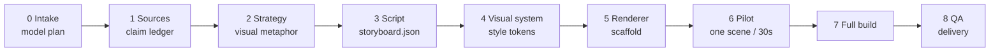

# explain-anything

> Turn complex material into understanding-optimized artifacts — with a fixed process and swappable models.

[](https://github.com/Temp0jd/explain-anything/actions/workflows/validate.yml)
[](LICENSE)
[](SKILL.md)
[](docs/model-selection.md)

Most explanations fail because they optimize for text, not understanding. This skill chooses the representation that makes an idea easiest to predict, debug, or decide with — then proves the representation is faithful.

It is **model-agnostic by design**: the pipeline is fixed, but the models for analysis, storyboard, implementation, and review are chosen explicitly at intake and recorded in `project.json`. No model is hardcoded to a content type.

## What it does

- **Forward mode:** explain a concept, paper, system, policy, or decision.
- **Reverse mode:** analyze an existing video into evidence-backed shots and a storyboard, then rebuild or remix it.
- **Artifact ladder:** calibrated answer → STE-lite prose → diagram → offline HTML → Manim/HyperFrames video → 2–5 minute knowledge film.
- **Source-grounded:** every number, name, date, equation, and causal claim gets a source anchor.
- **Visual-first video:** find a concrete image before writing the script; the subject must look like itself, and the verb must happen on screen.

## Why model-agnostic

The process should outlive any model. At intake, the agent asks:

> Which **provider and model** should I use for **analysis**, **storyboard**, **implementation**, and **review**? You can say "same for all", "auto", or name a provider and model per role.

The answer is recorded:

```json
{
  "models": {
    "analysis": { "status": "selected", "provider": "...", "model": "...", "selected_by": "user" },
    "storyboard": { "status": "selected", "provider": "...", "model": "...", "selected_by": "user" },
    "implementation": { "status": "selected", "provider": "...", "model": "...", "selected_by": "user" },
    "review": { "status": "selected", "provider": "...", "model": "...", "selected_by": "user" }
  }
}
```

If a provider or model changes mid-project, the change is logged in `model_history` and affected stages are re-run. No silent swaps. See `docs/model-selection.md`.

## Modes and artifacts

| Mode | Input | Output |
| --- | --- | --- |
| `forward` | concept, paper, system, policy, notes | explanation artifact |
| `reverse` | existing video / talk / animation | `analysis.json` + `storyboard.json`, optional rebuild |
| `hybrid` | reference video + new topic | reuse structure, not claims or assets |

| Artifact | Best when |
| --- | --- |
| `answer` | small, familiar, factual |
| `ste` | terminology, procedure, compliance, audit |
| `diagram` | structure, hierarchy, flow, state |
| `html` | a mechanism with variables or layers |
| `video` | change over time, derivation, intuition |
| `knowledge-film` | 2–5 min, 16:9, no narration, bottom captions, visual-first |

## Pipeline



Each stage has a gate. Do not advance on a failed gate. Full detail: `docs/pipeline.md`.

## Renderers

| Renderer | Best for |
| --- | --- |
| `manim` | equations, axes, geometry, LaTeX, 3D math |
| `hyperframes` | HTML/CSS/GSAP, typography, UI, charts, code, kinetic type |
| `remotion` | existing React/Remotion compositions |
| `canvas` | custom frame-by-frame 2D knowledge films |
| `static` | diagrams, posters, single-frame explainers |

A hybrid is allowed: Manim for the mathematical core, HyperFrames for title/chapter/end cards. Match `style_tokens` across both. See `references/renderers.md`.

## Quick start

```bash
git clone https://github.com/Temp0jd/explain-anything.git
cd explain-anything

python scripts/scaffold.py \
  --mode forward --artifact video --renderer hyperframes \
  --title "Why caches help" --language en --out ./explainers/caches

# 1. The agent asks which provider and model to use for analysis, storyboard, implementation, review.
# 2. Record the choices in ./explainers/caches/project.json.
# 3. Fill sources.md and storyboard.json.
# 4. Copy assets/model-registry.example.json to model-registry.json and add the providers you verified.

python scripts/validate_project.py ./explainers/caches/project.json
python scripts/validate_storyboard.py ./explainers/caches/storyboard.json
python scripts/preflight_model.py ./explainers/caches/project.json --registry model-registry.json
```

For a video, render a pilot before the full build. For HyperFrames:

```bash
cp assets/hyperframes/index.html ./explainers/caches/render/hyperframes/index.html
mkdir -p ./explainers/caches/render/hyperframes/compositions
cp assets/hyperframes/compositions/scene.html ./explainers/caches/render/hyperframes/compositions/scene.html
scripts/render_hyperframes.sh ./explainers/caches/render/hyperframes ./explainers/caches/render/out.mp4

# 4. QA and release check
python scripts/qa_video.py ./explainers/caches/render/out.mp4 --project caches \
  --storyboard ./explainers/caches/storyboard.json --require-audio
python scripts/check_release.py
```

## Repository layout

```text
explain-anything/
├── SKILL.md                  # the agent skill
├── README.md                 # this file
├── README.zh-CN.md           # Chinese README
├── docs/                     # pipeline, model selection, contracts, QA, publishing
├── references/               # STE, diagrams, HTML, video, knowledge film, reverse, renderers
├── assets/                   # HTML/STE/storyboard/HyperFrames templates
├── schemas/                  # JSON Schemas for all handoffs
├── scripts/                  # scaffold, validators, artifact checker, STE lint
├── tests/                    # pytest suite
├── examples/                 # Transformer example (HyperFrames)
└── .github/workflows/        # CI validation
```

## Examples

| Example | Renderer | What it shows |
| --- | --- | --- |
| [`transformer`](examples/transformer/) | HyperFrames | 107.9 s Chinese Transformer explainer, light academic style |

[](examples/transformer/)

Validate the example:

```bash
python scripts/validate_examples.py
```

## Install as a skill

Keep the repository folder name `explain-anything` and the root `SKILL.md`.

```bash
# Claude Code / Codex / Cursor-style skill directories
mkdir -p ~/.claude/skills
cp -r explain-anything ~/.claude/skills/explain-anything

# or skills.sh
npx skills add Temp0jd/explain-anything
```

## Design principles

1. **Understanding over format.** Climb the artifact ladder only as high as the idea needs.
2. **Source before prose.** Every claim gets an anchor before it gets a sentence.
3. **Image before caption.** For video, find the concrete visual subject before writing the script.
4. **Show the verb.** If the sentence says "cut", the screen cuts.
5. **One world, one meaning.** A palette, scale, and set of props stay consistent.
6. **Pilot before scale.** Render one scene or 30 seconds; fix the metaphor before the full build.
7. **Models are interchangeable; the contract is not.** Record choices; never swap silently.
8. **A beautiful artifact that distorts the idea is worse than a plain paragraph that is correct.**

## Validate

```bash
python -m pip install -r requirements-dev.txt
python -m pytest
python scripts/validate_examples.py
python scripts/check_artifact.py --kind dir examples/transformer
python scripts/preflight_model.py examples/transformer/project.json --registry assets/model-registry.example.json
python scripts/qa_video.py examples/transformer/render/final.mp4 --project transformer-example \
  --storyboard examples/transformer/storyboard.json --captions examples/transformer/captions.srt --require-audio
python scripts/check_release.py
```

## Attribution

This project integrates the author's original `explain-anything` material with ideas from:

- **vibe-knowledge-film** (MIT) — visual-first knowledge-film process, shot table, world presets, frame-by-frame review. https://github.com/HeyChengC/vibe-knowledge-film
- **HyperFrames** (Apache-2.0) — HTML/CSS/GSAP composition contract and CLI. https://github.com/heygen-com/hyperframes
- **Manim Community** (MIT) — mathematical animation. https://www.manim.community/

See `NOTICE.md` for details and license boundaries.

## License

MIT. See `LICENSE`.
