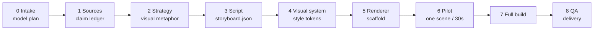

<div align="center">

# claim-to-frame

**A skill for turning source material into diagrams, interactive pages, and short films that stay close to the evidence.**

[English](README.md) · [简体中文](README.zh-CN.md)

[](https://github.com/Temp0jd/claim-to-frame/actions/workflows/validate.yml)
[](LICENSE)
[](CHANGELOG.md)
[](requirements.txt)
[](SKILL.md)
[](docs/model-selection.md)

</div>

---

Technical explanations often default to paragraphs, even when the idea needs a diagram, an interactive page, or motion.

**claim-to-frame** is an agent skill for turning source documents, notes, or existing videos into explanation artifacts. It extracts claims into a ledger, chooses a medium, and builds a checked deliverable: for example, an interactive HTML model or a timed knowledge film with narration and subtitles.

## Quick start

Install into your agent skills directory:

```bash
npx skills add Temp0jd/claim-to-frame -g -y
```

Or install manually:

```bash
git clone https://github.com/Temp0jd/claim-to-frame.git
mkdir -p ~/.claude/skills
cp -r claim-to-frame ~/.claude/skills/claim-to-frame
```

Python 3.10+ covers the contracts and scripts. Video QA needs FFmpeg/FFprobe; HyperFrames needs Node 22+ and Chrome. Renderer-specific dependencies are in [`references/renderers.md`](references/renderers.md).

Scaffold a project and run the validation flow:

```bash
# 1. Initialize a project workspace
python scripts/scaffold.py \
  --mode forward --artifact video --renderer hyperframes \
  --title "Why caches help" --language en --out ./explainers/caches

# 2. Record provider and model selections in project.json, then prepare sources.md and storyboard.json

# 3. Validate contracts and check model configuration
python scripts/validate_project.py ./explainers/caches/project.json
python scripts/validate_storyboard.py ./explainers/caches/storyboard.json
python scripts/preflight_model.py ./explainers/caches/project.json --registry assets/model-registry.example.json

# 4. Render a pilot scene before building the full video
scripts/render_hyperframes.sh ./explainers/caches/render/hyperframes ./explainers/caches/render/out.mp4
python scripts/qa_video.py ./explainers/caches/render/out.mp4 --project caches \
  --storyboard ./explainers/caches/storyboard.json
# The pilot is silent. Add --require-audio after you mux narration.
```

## What this is and what this is not

| What this is | What this is not |
| --- | --- |
| An Agent Skill with a staged workflow | An npm library, CLI binary, or desktop app |
| JSON contracts, stage gates, and validation scripts | A collection of unstructured prompts or copy-paste templates |
| Model-agnostic: analysis, storyboard, code, and review roles are explicit | A wrapper around one model |
| Source-grounded: every factual claim links to an anchor | A tool that generates claims without sources |
| Renderer-agnostic: Manim, HyperFrames, Remotion, Canvas, or static HTML | A Manim-only exporter |

## How it works

The workflow splits production into explicit stages. Major handoffs have a written contract; JSON files are validated against schemas. If a stage gate fails, execution pauses until the issue is fixed.



See [`docs/pipeline.md`](docs/pipeline.md) for detailed entrance and exit criteria at each stage.

## Modes and artifacts

### Modes

The skill operates in three modes:

- `forward`: explain a concept, paper, system, policy, or codebase from scratch.
- `reverse`: analyze an existing video into evidence-backed shots and structured storyboard data, then rebuild or inspect it.
- `hybrid`: borrow the pacing and visual structure of a reference explainer while supplying new claims and assets.

### The artifact ladder

Match the deliverable to the reader's problem. Pick the lowest sufficient rung:

| Artifact | Rung | Best when |
| --- | --- | --- |
| `answer` | 0 | Small, familiar, factual questions |
| `ste` | 1 | Procedural instructions, compliance, terminology, and audits |
| `diagram` | 2 | Structure, hierarchy, sequence flows, and system state |
| `html` | 3 | Mechanisms with state machines, parameters, or interactive layers |
| `video` | 4 | Derivations, dynamic systems, and intuition over time |
| `knowledge-film` | 4 | 2–5 minute visual-first explainers (16:9, subtitle-driven, rhythm-matched) |

## Model-agnostic role selection

The skill separates workflow logic from model choices. At intake, the agent prompts for provider and model assignments across four operational roles:

- `analysis`: parses references, transcripts, data tables, and keyframes.
- `storyboard`: writes narrative arcs, shot descriptions, and on-screen actions.
- `implementation`: generates renderer code (HTML/CSS/GSAP, Python Manim, React Remotion) and runs builds.
- `review`: audits factual fidelity, visual legibility, subtitle alignment, and contrast.

All choices are saved directly in `project.json`:

```json
{
  "models": {
    "analysis":       { "status": "selected", "provider": "command-code", "model": "deepseek/deepseek-v4.1-flash", "selected_by": "user" },
    "storyboard":     { "status": "selected", "provider": "command-code", "model": "deepseek/deepseek-v4.1-flash", "selected_by": "user" },
    "implementation": { "status": "selected", "provider": "command-code", "model": "deepseek/deepseek-v4.1-flash", "selected_by": "user" },
    "review":         { "status": "selected", "provider": "command-code", "model": "deepseek/deepseek-v4.1-flash", "selected_by": "user" }
  }
}
```

A model is never inferred from a provider name; provider and model are recorded separately. A provider or model is never swapped without logging to `model_history`. The script `scripts/preflight_model.py` validates that selected models meet capability requirements before rendering begins. See [`docs/model-selection.md`](docs/model-selection.md).

## Renderers

Renderers are swappable backends:

| Renderer | Best suited for |
| --- | --- |
| `hyperframes` | HTML/CSS/GSAP, typography, UI, charts, code, and 2D layouts |
| `manim` | Equations, axes, geometry, LaTeX, and 3D math |
| `remotion` | Existing React/Remotion projects |
| `canvas` | Custom frame-by-frame 2D animation |
| `static` | SVG/PNG diagrams, posters, and flowcharts |

You can mix renderers: Manim for the mathematical core, HyperFrames for title, chapter, and end cards, with shared style tokens. See [`references/renderers.md`](references/renderers.md).

## Worked example: Transformer explainer

The repository includes a 107.9-second Chinese Transformer explainer, built with HyperFrames in a light academic style.

<p align="center">
  <a href="examples/transformer/">
    
  </a>
</p>

<p align="center">
  <a href="examples/transformer/"><strong>View the Transformer explainer files →</strong></a>
</p>

The example demonstrates:
- Grounded claim citations linking script statements to Vaswani et al. (2017) in `sources.md`.
- Monotonic shot timing and on-screen action specifications in `storyboard.json`.
- Programmatic HTML/CSS/GSAP animation code in `compositions/scene.html`.
- QA results in `qa_report.json` for contrast, layout, runtime, decode, and captions.

## Quality gates and validation

The main artifacts are checked by deterministic scripts and gates:

| Quality gate | Scope and verification |
| --- | --- |
| Source ledger | Every number, definition, formula, and causal claim has a source anchor. |
| Model preflight | `scripts/preflight_model.py` checks provider, model, and required capabilities in `project.json`. |
| Storyboard contract | `scripts/validate_storyboard.py` checks monotonic scene time offsets and required visual actions. |
| Audio retiming | `scripts/retime_storyboard.py` aligns storyboard scene boundaries with actual TTS narration durations. |
| Video QA | `scripts/qa_video.py` inspects stream codecs, loudness, black frames, decode integrity, and subtitle tracks. |
| Release scan | `scripts/check_release.py` checks for placeholders, absolute paths, secrets, invalid JSON, and missing files. |

Run the full validation suite locally:

```bash
python -m pytest
python scripts/validate_examples.py
python scripts/check_release.py --strict
```

## Repository map

<details>
<summary>View directory structure</summary>

```text
claim-to-frame/
├── SKILL.md                  # Skill instructions loaded by agent runtimes
├── README.md                 # English documentation
├── README.zh-CN.md           # Chinese documentation
├── docs/                     # Pipeline stages, model selection rules, QA guides
├── references/               # Guides for STE, diagrams, HTML widgets, and video renderers
├── assets/                   # Templates, style tokens, and example model registries
├── schemas/                  # JSON Schemas for project, storyboard, manifest, and QA files
├── scripts/                  # Scaffolding, validators, preflight, QA, and release tools
├── tests/                    # Automated pytest test cases
├── examples/transformer/     # Complete HyperFrames worked explainer
└── .github/workflows/        # Continuous integration workflows
```

</details>

## Design principles

1. **Format serves understanding.** Do not build a video when an annotated diagram answers the question.
2. **Anchors before text.** Every factual claim must link to a verified source before drafting script lines.
3. **Image before script.** For video, identify the physical or spatial subject before writing narration.
4. **Show the verb.** If the script states that data is filtered, the animation must visibly filter elements on screen.
5. **One visual world.** Maintain consistent palettes, coordinate scales, and visual metaphors across scenes.
6. **Pilot before scaling.** Render a 30-second pilot sequence to validate layout and timing before full builds.
7. **Swappable models, permanent contracts.** Model choices are tracked in `project.json` and never swapped implicitly.
8. **Correctness over spectacle.** An unembellished, factually accurate paragraph is preferable to an attractive animation that misrepresents how a mechanism works.

## Attribution

This project builds upon the author's original `explain-anything` framework and adopts concepts from related open-source projects:

- **vibe-knowledge-film** (MIT) — Visual-first knowledge film conventions, shot table structure, and frame review methodology. https://github.com/HeyChengC/vibe-knowledge-film
- **HyperFrames** (Apache-2.0) — HTML/CSS/GSAP composition contract and render CLI. https://github.com/heygen-com/hyperframes
- **Manim Community** (MIT) — Mathematical animation engine. https://www.manim.community/

See [`NOTICE.md`](NOTICE.md) for license notices and attribution details.

## License

MIT. See [`LICENSE`](LICENSE).
