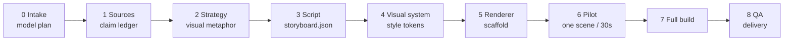

<div align="center">

# claim-to-frame

**Source-grounded explanations, rendered as the artifact the idea deserves.**

From a claim ledger to a diagram, an interactive page, or a 5-minute knowledge film.

[English](README.md) · [简体中文](README.zh-CN.md)

[](https://github.com/Temp0jd/claim-to-frame/actions/workflows/validate.yml)
[](LICENSE)
[](CHANGELOG.md)
[](requirements.txt)
[](SKILL.md)
[](docs/model-selection.md)

</div>

---

Most explanations fail because they optimize for text, not understanding. **claim-to-frame** is a model-agnostic agent skill that starts with evidence, chooses the representation the idea needs, and carries it through to a finished artifact.

It is a workflow, not a prompt pack: every stage has a written contract and a gate.

## Why this exists

A good explanation is not a longer answer. It is the right representation: a diagram for structure, an interactive page for a mechanism, a video for change over time. The representation has to stay faithful to the source.

`claim-to-frame` makes that trade-off explicit:

| It is | It is not |
| --- | --- |
| A staged workflow with contracts and gates | A one-shot prompt |
| Source-grounded: claims carry anchors | A fact generator |
| Renderer-agnostic: Manim, HyperFrames, HTML, Canvas | A Manim-only template |
| Model-agnostic: four explicit roles | A wrapper around one model |
| Designed to be inspected and revised | A black box that outputs a file |

## What it does

| Capability | What you get |
| --- | --- |
| **Forward mode** | Explain a concept, paper, system, policy, or decision from scratch |
| **Reverse mode** | Turn an existing video into evidence-backed shots and a storyboard, then rebuild or remix it |
| **Hybrid mode** | Reuse a reference's structure, not its claims or assets |
| **Artifact ladder** | Answer → STE-lite prose → diagram → offline HTML → video → knowledge film |
| **Visual-first video** | Find a concrete image before writing the script; the verb must happen on screen |
| **Contracts** | `project.json`, `storyboard.json`, `render_manifest.json`, `qa_report.json` |
| **Quality gates** | Source ledger, model preflight, storyboard validation, video QA, release scan |

## How it works



Each stage has a gate. A failed gate stops the pipeline until the artifact is fixed. The full procedure is in [`docs/pipeline.md`](docs/pipeline.md).

## Modes and artifacts

| Mode | Input | Output |
| --- | --- | --- |
| `forward` | concept, paper, system, policy, notes | explanation artifact |
| `reverse` | existing video, talk, or animation | `analysis.json` + `storyboard.json`, optional rebuild |
| `hybrid` | reference video + new topic | same structure, new claims and visuals |

| Artifact | Best when |
| --- | --- |
| `answer` | small, familiar, factual |
| `ste` | terminology, procedure, compliance, audit |
| `diagram` | structure, hierarchy, flow, state |
| `html` | a mechanism with variables or layers |
| `video` | change over time, derivation, intuition |
| `knowledge-film` | 2–5 min, 16:9, no narration, bottom captions, visual-first |

## Model-agnostic by design

The process should outlive any model. At intake, the agent asks one explicit question:

> Which **provider and model** should I use for **analysis**, **storyboard**, **implementation**, and **review**?

You can answer "same for all", "auto", or name a provider and model per role. The choice is written to `project.json`:

```json
{
  "models": {
    "analysis":       { "status": "selected", "provider": "...", "model": "...", "selected_by": "user" },
    "storyboard":     { "status": "selected", "provider": "...", "model": "...", "selected_by": "user" },
    "implementation": { "status": "selected", "provider": "...", "model": "...", "selected_by": "user" },
    "review":         { "status": "selected", "provider": "...", "model": "...", "selected_by": "user" }
  }
}
```

A model family is not a provider. `deepseek/deepseek-v4.1-flash` can be served by more than one gateway, with different quota and capabilities. `scripts/preflight_model.py` checks the provider, model, and required capabilities before rendering.

If a provider or model changes mid-project, the change is logged in `model_history` and affected stages are re-run. No silent swaps. See [`docs/model-selection.md`](docs/model-selection.md).

## Renderers

| Renderer | Best for |
| --- | --- |
| `manim` | equations, axes, geometry, LaTeX, 3D math |
| `hyperframes` | HTML/CSS/GSAP, typography, UI, charts, code, kinetic type |
| `remotion` | existing React/Remotion compositions |
| `canvas` | custom frame-by-frame 2D knowledge films |
| `static` | diagrams, posters, single-frame explainers |

A hybrid is allowed: Manim for the mathematical core, HyperFrames for title, chapter, and end cards. Match `style_tokens` across both. See [`references/renderers.md`](references/renderers.md).

## Quick start

```bash
git clone https://github.com/Temp0jd/claim-to-frame.git
cd claim-to-frame

python scripts/scaffold.py \
  --mode forward --artifact video --renderer hyperframes \
  --title "Why caches help" --language en --out ./explainers/caches

# 1. The agent asks which provider and model to use for each role.
# 2. Record the choices in ./explainers/caches/project.json.
# 3. Fill sources.md and storyboard.json.
# 4. Copy assets/model-registry.example.json to model-registry.json.

python scripts/validate_project.py ./explainers/caches/project.json
python scripts/validate_storyboard.py ./explainers/caches/storyboard.json
python scripts/preflight_model.py ./explainers/caches/project.json --registry model-registry.json
```

For HyperFrames, render a pilot before the full build:

```bash
cp assets/hyperframes/index.html ./explainers/caches/render/hyperframes/index.html
mkdir -p ./explainers/caches/render/hyperframes/compositions
cp assets/hyperframes/compositions/scene.html ./explainers/caches/render/hyperframes/compositions/scene.html
scripts/render_hyperframes.sh ./explainers/caches/render/hyperframes ./explainers/caches/render/out.mp4

python scripts/qa_video.py ./explainers/caches/render/out.mp4 --project caches \
  --storyboard ./explainers/caches/storyboard.json --require-audio
```

## Example

A 107.9-second Chinese Transformer explainer in a light academic style, built with HyperFrames.

<p align="center">
  <a href="examples/transformer/">
    
  </a>
</p>

<p align="center">
  <a href="examples/transformer/"><strong>Open the example →</strong></a>
</p>

Validate it:

```bash
python scripts/validate_examples.py
```

## Install

```bash
npx skills add Temp0jd/claim-to-frame -g -y
```

Or install manually:

```bash
git clone https://github.com/Temp0jd/claim-to-frame.git
mkdir -p ~/.claude/skills
cp -r claim-to-frame ~/.claude/skills/claim-to-frame
```

Keep the folder name `claim-to-frame` and the root `SKILL.md`.

## Repository map

<details>
<summary>Show the full layout</summary>

```text
claim-to-frame/
├── SKILL.md                  # the agent skill
├── README.md                 # English README
├── README.zh-CN.md           # Chinese README
├── docs/                     # pipeline, model selection, contracts, QA, publishing
├── references/               # STE, diagrams, HTML, video, knowledge film, reverse, renderers
├── assets/                   # HTML, STE, storyboard, HyperFrames, model registry
├── schemas/                  # JSON Schemas for all handoffs
├── scripts/                  # scaffold, validators, preflight, QA, retiming, release check
├── tests/                    # pytest suite
├── examples/transformer/     # worked example with video and contracts
└── .github/workflows/        # CI validation
```

</details>

## Quality gates

| Gate | What it proves |
| --- | --- |
| Source ledger | Every number, name, date, equation, and causal claim has an anchor |
| Model preflight | The selected provider and model can do the job |
| Storyboard contract | Timings are monotonic; every scene has a visual, action, and acceptance check |
| Pilot | One scene or 30 seconds works before the full build |
| Video QA | Streams, audio, decode, black frames, captions, and OCR are checked |
| Release scan | No placeholders, absolute paths, secrets, or missing files |

## Design principles

1. **Understanding over format.** Climb the artifact ladder only as high as the idea needs.
2. **Source before prose.** Every claim gets an anchor before it gets a sentence.
3. **Image before caption.** For video, find the concrete visual subject before writing the script.
4. **Show the verb.** If the sentence says "cut", the screen cuts.
5. **One world, one meaning.** A palette, scale, and set of props stay consistent.
6. **Pilot before scale.** Fix the visual metaphor before the full build.
7. **Models are interchangeable; the contract is not.** Record choices; never swap silently.
8. **A beautiful artifact that distorts the idea is worse than a plain paragraph that is correct.**

## Validate

```bash
python -m pip install -r requirements-dev.txt
python -m pytest
python scripts/validate_examples.py
python scripts/preflight_model.py examples/transformer/project.json --registry assets/model-registry.example.json
python scripts/qa_video.py examples/transformer/render/final.mp4 --project transformer-example \
  --storyboard examples/transformer/storyboard.json --captions examples/transformer/captions.srt --require-audio
python scripts/check_artifact.py --kind dir examples/transformer
python scripts/check_release.py --strict
```

## Attribution

This project integrates the author's original `explain-anything` material with ideas from:

- **vibe-knowledge-film** (MIT) — visual-first knowledge-film process, shot table, world presets, frame-by-frame review. https://github.com/HeyChengC/vibe-knowledge-film
- **HyperFrames** (Apache-2.0) — HTML/CSS/GSAP composition contract and CLI. https://github.com/heygen-com/hyperframes
- **Manim Community** (MIT) — mathematical animation. https://www.manim.community/

See [`NOTICE.md`](NOTICE.md) for details and license boundaries.

## License

MIT. See [`LICENSE`](LICENSE).
