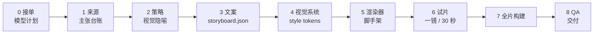

<div align="center">

# claim-to-frame

**把复杂材料，做成它真正需要的表达。**

从主张台账，到图表、交互页面，或一支 5 分钟知识短片。

[English](README.md) · [简体中文](README.zh-CN.md)

[](https://github.com/Temp0jd/claim-to-frame/actions/workflows/validate.yml)
[](LICENSE)
[](CHANGELOG.md)
[](requirements.txt)
[](SKILL.md)
[](docs/model-selection.md)

</div>

---

大多数解释失败，是因为它们优化的是“文字”，不是“理解”。**claim-to-frame** 是一个模型无关的 Agent Skill：先收集证据，再选择概念真正需要的表达，最后把它做成一个完整产物。

它是一套有契约、有门禁的流程，不是一堆提示词。

## 为什么做这个

好的解释不是更长的回答，而是正确的表达：结构用图表，机制用交互页面，随时间变化的东西用视频。表达还必须忠于来源。

`claim-to-frame` 把这件事变成显式流程：

| 它是 | 它不是 |
| --- | --- |
| 有契约、有门禁的阶段式流程 | 一次性提示词 |
| 来源可追溯：每个主张都有锚点 | 事实生成器 |
| 渲染器无关：Manim、HyperFrames、HTML、Canvas | 只服务 Manim 的模板 |
| 模型无关：四个角色显式选择 | 绑定某一个模型的封装 |
| 可检查、可修改 | 输出一个文件的黑盒 |

## 能做什么

| 能力 | 你会得到 |
| --- | --- |
| **正向模式** | 从零解释概念、论文、系统、政策或决策 |
| **逆向模式** | 把已有视频拆成有证据锚点的镜头表和分镜，再重建或改写 |
| **混合模式** | 复用参考视频的结构，不复用它的观点或素材 |
| **产物阶梯** | 回答 → STE-lite 文本 → 图表 → 离线 HTML → 视频 → 知识短片 |
| **视觉先行** | 先找到具体形象，再写文案；句子里的动词要在屏幕上真的发生 |
| **契约文件** | `project.json`、`storyboard.json`、`render_manifest.json`、`qa_report.json` |
| **质量门** | 来源台账、模型预检、分镜校验、视频 QA、发布扫描 |

## 工作流



每一阶段都有门禁；门禁不过就停下来修产物。完整流程见 [`docs/pipeline.md`](docs/pipeline.md)。

## 模式与产物

| 模式 | 输入 | 输出 |
| --- | --- | --- |
| `forward` | 概念、论文、系统、政策、笔记 | 解释产物 |
| `reverse` | 已有视频、演讲或动画 | `analysis.json` + `storyboard.json`，可选重建 |
| `hybrid` | 参考视频 + 新主题 | 相同结构，新的主张和画面 |

| 产物 | 适合 |
| --- | --- |
| `answer` | 小、熟、事实型问题 |
| `ste` | 术语、流程、合规、审计 |
| `diagram` | 结构、层级、流程、状态 |
| `html` | 有变量、反事实、分层的机制 |
| `video` | 随时间变化、推导、直觉 |
| `knowledge-film` | 2–5 分钟、16:9、无旁白、底部字幕、视觉先行 |

## 模型无关

流程应该比任何模型活得久。开始时，Agent 会问一个明确的问题：

> 分析、分镜、实现、审核四个角色，分别用哪个 **provider 和模型**？

你可以回答“全部同一个”“自动推荐”，也可以逐个指定。选择会写进 `project.json`：

```json
{
  "models": {
    "analysis":       { "status": "selected", "provider": "...", "model": "...", "selected_by": "user" },
    "storyboard":     { "status": "selected", "provider": "...", "model": "...", "selected_by": "user" },
    "implementation": { "status": "selected", "provider": "...", "model": "...", "selected_by": "user" },
    "review":         { "status": "selected", "provider": "...", "model": "...", "selected_by": "user" }
  }
}
```

模型家族不等于 provider。`deepseek/deepseek-v4.1-flash` 可能由多个网关提供，额度和能力不同。`scripts/preflight_model.py` 会在渲染前检查 provider、模型和所需能力。

中途换 provider 或模型会写入 `model_history`，并重跑受影响阶段；不允许静默切换。详见 [`docs/model-selection.md`](docs/model-selection.md)。

## 渲染器

| 渲染器 | 适合 |
| --- | --- |
| `manim` | 公式、坐标轴、几何、LaTeX、3D 数学 |
| `hyperframes` | HTML/CSS/GSAP、排版、UI、图表、代码、动态字 |
| `remotion` | 已有 React/Remotion 工程 |
| `canvas` | 自定义逐帧 2D 知识短片 |
| `static` | 图表、海报、单帧解释 |

可以混合：Manim 做数学主体，HyperFrames 做片头、章节卡和片尾，共用 `style_tokens`。详见 [`references/renderers.md`](references/renderers.md)。

## 快速开始

```bash
git clone https://github.com/Temp0jd/claim-to-frame.git
cd claim-to-frame

python scripts/scaffold.py \
  --mode forward --artifact video --renderer hyperframes \
  --title "为什么缓存有用" --language zh-CN --out ./explainers/caches

# 1. Agent 询问四个角色分别用什么 provider 和模型
# 2. 把选择写进 ./explainers/caches/project.json
# 3. 填写 sources.md 和 storyboard.json
# 4. 复制 assets/model-registry.example.json 为 model-registry.json

python scripts/validate_project.py ./explainers/caches/project.json
python scripts/validate_storyboard.py ./explainers/caches/storyboard.json
python scripts/preflight_model.py ./explainers/caches/project.json --registry model-registry.json
```

HyperFrames 视频先做试片，再铺全片：

```bash
cp assets/hyperframes/index.html ./explainers/caches/render/hyperframes/index.html
mkdir -p ./explainers/caches/render/hyperframes/compositions
cp assets/hyperframes/compositions/scene.html ./explainers/caches/render/hyperframes/compositions/scene.html
scripts/render_hyperframes.sh ./explainers/caches/render/hyperframes ./explainers/caches/render/out.mp4

python scripts/qa_video.py ./explainers/caches/render/out.mp4 --project caches \
  --storyboard ./explainers/caches/storyboard.json --require-audio
```

## 示例

一支 107.9 秒的中文 Transformer 讲解视频，浅色学术风，使用 HyperFrames 构建。

<p align="center">
  <a href="examples/transformer/">
    
  </a>
</p>

<p align="center">
  <a href="examples/transformer/"><strong>打开示例 →</strong></a>
</p>

校验示例：

```bash
python scripts/validate_examples.py
```

## 安装

```bash
npx skills add Temp0jd/claim-to-frame -g -y
```

或手动安装：

```bash
git clone https://github.com/Temp0jd/claim-to-frame.git
mkdir -p ~/.claude/skills
cp -r claim-to-frame ~/.claude/skills/claim-to-frame
```

保持文件夹名为 `claim-to-frame`，根目录有 `SKILL.md`。

## 仓库结构

<details>
<summary>展开完整目录</summary>

```text
claim-to-frame/
├── SKILL.md                  # Agent 技能入口
├── README.md                 # 英文 README
├── README.zh-CN.md           # 中文 README
├── docs/                     # 流程、模型选择、契约、QA、发布
├── references/               # STE、图表、HTML、视频、知识短片、逆向、渲染器
├── assets/                   # HTML、STE、分镜、HyperFrames、模型注册表
├── schemas/                  # 所有交接文件的 JSON Schema
├── scripts/                  # 脚手架、校验、预检、QA、重定时、发布检查
├── tests/                    # pytest 测试
├── examples/transformer/     # 完整示例：视频 + 契约
└── .github/workflows/        # CI 校验
```

</details>

## 质量门

| 门禁 | 它证明什么 |
| --- | --- |
| 来源台账 | 每个数字、人名、日期、公式、因果判断都有出处 |
| 模型预检 | 选定的 provider 和模型确实能完成工作 |
| 分镜契约 | 时间单调；每幕都有画面、动作和验收条件 |
| 试片 | 全片之前，一镜或 30 秒已经成立 |
| 视频 QA | 流、音频、解码、黑帧、字幕和 OCR 都被检查 |
| 发布扫描 | 没有占位符、绝对路径、密钥或缺失文件 |

## 设计原则

1. **理解为上**：只在概念需要时，才爬升到更复杂的产物。
2. **先来源，后文字**：每个主张先有锚点，再写句子。
3. **先形象，后字幕**：视频先找到具体主体，再写文案。
4. **让动词发生**：说“砍”，画面就真的砍。
5. **一个世界，一个含义**：配色、尺度、道具全片一致。
6. **先试片，再铺全片**：先修正视觉隐喻，再规模化。
7. **模型可换，契约不换**：记录选择，不静默切换。
8. **漂亮但歪曲原意的产物，不如一段正确但朴素的文字。**

## 校验

```bash
python -m pip install -r requirements-dev.txt
python -m pytest
python scripts/validate_examples.py
python scripts/preflight_model.py examples/transformer/project.json --registry assets/model-registry.example.json
python scripts/qa_video.py examples/transformer/render/final.mp4 --project transformer-example \
  --storyboard examples/transformer/storyboard.json --captions examples/transformer/captions.srt --require-audio
python scripts/check_artifact.py --kind dir examples/transformer
python scripts/check_release.py --strict
```

## 致谢

本项目整合了作者原有的 `explain-anything` 材料，并参考了：

- **vibe-knowledge-film**（MIT）：视觉先行知识短片流程、镜头表、世界预设、逐帧检查。https://github.com/HeyChengC/vibe-knowledge-film
- **HyperFrames**（Apache-2.0）：HTML/CSS/GSAP 组合契约与 CLI。https://github.com/heygen-com/hyperframes
- **Manim Community**（MIT）：数学动画。https://www.manim.community/

详见 [`NOTICE.md`](NOTICE.md)。

## 许可

MIT。见 [`LICENSE`](LICENSE)。
