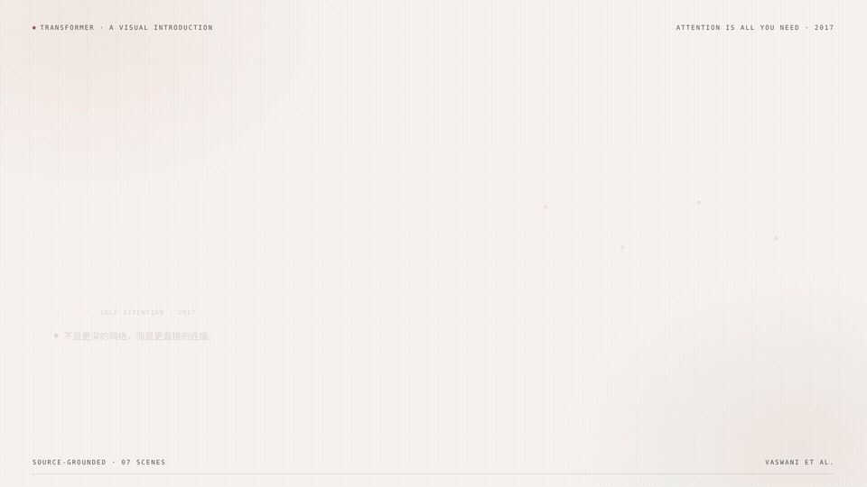

# Transformer — A Visual Introduction



A 107.9-second Chinese explainer in a light, fresh, academic style: warm paper background, terracotta accent, serif headings, generous margins, and restrained diagrams.

- Video: `render/final.mp4` — 1920×1080, 30 fps, H.264 + AAC, Chinese narration + soft subtitles
- Source: `index.html`, `compositions/scene.html` (HTML/CSS/GSAP, HyperFrames 0.8.181)
- Storyboard: `storyboard.md`, `storyboard.json`
- Claim ledger: `sources.md`
- Project record: `project.json`
- Render/QA: `render_manifest.json`, `qa_report.json`
- Cover: `thumbnail.png`

## What it covers

1. Hook: every token can directly see every other token.
2. The old way: recurrence reads one step at a time; long-range information is diluted.
3. Self-attention: Q / K / V, scaled dot-product, softmax, weighted sum.
4. Multi-head attention: parallel relation patterns, concat, output projection.
5. Positional encoding: attention has no order; position information is added back.
6. The Transformer block: attention + feed-forward + residual + layer norm, stacked N times.
7. Recap: direct connection, parallelism, multi-head, position; the O(n²) cost; the paper.

## Audience

Readers who know what a token is and have seen vectors, but do not want a full derivation. The video is intuition-first; the equations are labels for the mechanism, not a proof.

## Style tokens

| Token | Value |
| --- | --- |
| Background | `#F7F4EE` |
| Surface | `#FFFDF9` |
| Ink | `#2F2A26` |
| Accent | `#A64B2E` |
| Sage | `#4F6F5D` |
| Blue | `#46637D` |
| Display font | `Noto Serif CJK SC` |
| Body font | `Noto Sans CJK SC` |
| Mono font | `DejaVu Sans Mono` |
| Safe margin | 96 px at 1920×1080 |

The palette is deliberately warm and low-contrast in decoration, but all text passes WCAG AA (HyperFrames check: 109/109 text checks).

## Files

| File | Purpose |
| --- | --- |
| `render/final.mp4` | Final video with narration and soft subtitles |
| `preview.gif` | 9-second silent preview for README/GitHub |
| `index.html` | Host composition; mounts the scene sub-composition |
| `compositions/scene.html` | Seven scenes, CSS, and the GSAP timeline |
| `narration.md` | Narration script |
| `captions.srt` / `captions.vtt` | Chinese captions |
| `audio/S01.mp3` … `S07.mp3` | Per-scene TTS |
| `audio/timings.json` | Scene starts, durations, lead/tail |
| `assets/transformer.css` | Scene CSS (kept external for readability) |
| `assets/gsap.min.js` | Vendored GSAP 3.14.2 (standard license) |
| `make_audio.py` | Regenerate TTS and timings |
| `build_audio.py` | Pad, loudnorm, concatenate narration, build captions |
| `storyboard.md` | Human-readable shot table |
| `storyboard.json` | Machine-readable contract |
| `sources.md` | Claim ledger and references |
| `project.json` | Mode, artifact, model roles, stage status |
| `render_manifest.json` | Renderer output and checks |
| `qa_report.json` | QA results |

## Open the video

```bash
mpv render/final.mp4
# or
ffplay render/final.mp4
```

Subtitles are a sidecar (`captions.srt`) and a soft subtitle track in the MP4. Select the Chinese subtitle track in your player.

## Rebuild

Requirements: Python 3.10+, Node.js 22+, FFmpeg, Chromium/Chrome, and a CJK font such as Noto Sans/Serif CJK SC. HyperFrames is pinned to `0.8.181`.

```bash
# 1. TTS (requires edge-tts 7.3.x; set EDGE_TTS if it is not on PATH)
EDGE_TTS=/path/to/edge-tts python3 make_audio.py

# 2. Pad, normalize, concatenate, captions
python3 build_audio.py

# 3. Check the composition
npx hyperframes@0.8.181 check

# 4. Render silent scenes
npx hyperframes@0.8.181 render --fps 30 --quality high --workers 4 -o render/silent.mp4

# 5. Mux narration and subtitles
ffmpeg -i render/silent.mp4 -i audio/narration.wav -i captions.srt \
  -map 0:v:0 -map 1:a:0 -map 2:s:0 \
  -c:v copy -c:a aac -b:a 192k -af "apad=pad_dur=0.5" \
  -c:s mov_text -metadata:s:s:0 language=zho \
  -movflags +faststart -t 107.900 render/final.mp4
```

## Model choices

`project.json` records four roles: analysis, storyboard, implementation, review. This example records the honest default (`single-session` / `current-session`) because one session performed all roles. When reusing this project, ask the user which provider and model to use for each role and replace them. Do not infer a model from a brand name; do not swap silently.

## Simplifications

- The 5×5 matrix and its weights are illustrative, not measured from a trained model.
- The video shows a single encoder-style block for intuition; it omits decoder masking, cross-attention, training objectives, and specific LLM architectures.
- `O(n²)` refers to the attention matrix over sequence length; optimized kernels and sparse/linear attention change constants and sometimes asymptotics.
- The token sentence "猫 坐 在 垫子 上" is an example, not a linguistic claim.
- The video is 107.9 seconds; it is an introduction, not a complete course.

## Sources

See `sources.md`. Primary source: Vaswani et al., "Attention Is All You Need" (NeurIPS 2017, arXiv:1706.03762).

## QA

- HyperFrames check: 0 errors; 0 runtime, layout, and contrast errors; one file-size warning (the composition is 330+ lines).
- Layout: 0 issues across 9 samples.
- Contrast: 109/109 text checks pass WCAG AA.
- Video: 1920×1080, 30 fps, 107.9 s; H.264 + AAC 48 kHz stereo + soft Chinese subtitles.
- Decode: no errors; no black frames.
- Captions: 26 cues.
- Audio: mean −19.5 dB, max −4.5 dB.
