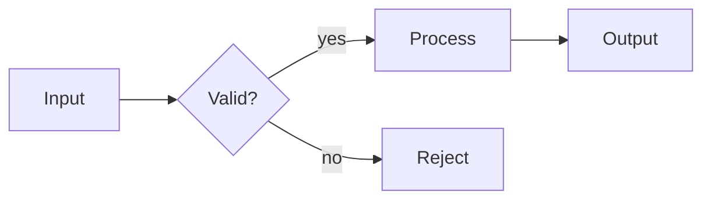
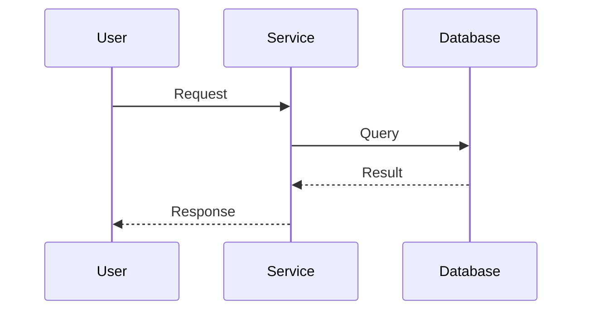
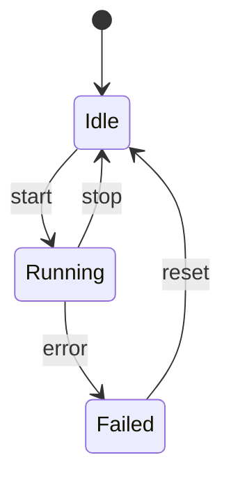
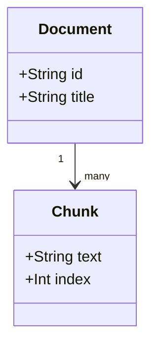

# Diagrams that explain

A diagram is an argument about structure. A diagram that shows everything explains nothing. Decide the argument, then choose the smallest visual that supports it.

## Diagram brief

Write this before drawing:

```text
Thesis: This diagram shows that <cause> leads to <effect> through <mechanism>.
Audience: <what they already know>.
Primary reading direction: <left-to-right | top-to-bottom | cycle>.
Primary nodes: <5-9>.
Key path: <the path the eye must follow>.
Takeaway: <one sentence the reader should retain>.
Simplification: <what is omitted>.
Source: <anchor>.
```

If you cannot write the thesis, the diagram is not ready.

## Choose the type

| Need | Type | Default direction |
| --- | --- | --- |
| Process, decision, pipeline | Flowchart | Left-to-right |
| Interaction over time | Sequence diagram | Top-to-bottom |
| Lifecycle, state machine | State diagram | Left-to-right or cycle |
| Hierarchy, ownership | Tree or nested containers | Top-to-bottom |
| Dependencies, citations, causal graph | Directed graph | Left-to-right |
| Quantitative comparison | Bar, line, or dot plot | Horizontal baseline |
| Two-dimensional trade-off | Quadrant or scatter | Cartesian axes |
| Physical or spatial layout | Annotated schematic | Match the real geometry |

## Complexity budget

- 5-9 primary nodes in the first view.
- 1-2 edge types. If you need more, use labels or a legend.
- 3 colors plus neutrals. Use one accent for the focal path.
- One primary reading direction. Avoid arrows that point backward unless the backward path is the point.
- One title. The title is a claim, not a category.
- One caption. The caption adds the interpretation; it does not repeat the labels.

If the budget is exceeded, split the diagram into layers: overview, mechanism, failure modes. Link the layers with the same node names and colors.

## Layout rules

- Align nodes to a grid. Uneven spacing reads as unequal importance.
- Put the start at the left or top. Put the outcome at the right or bottom.
- Keep the key path on a straight line when possible.
- Group related nodes with a container, not with a cloud of arrows.
- Avoid crossing edges. Reroute, reorder, or split the diagram.
- Give every node a noun or a short noun phrase. Give every edge a verb or relation.
- Do not use an arrow for "related to". Use a labeled line or a containment relation.
- Put labels close to the thing they describe. Avoid legends when direct labels fit.
- Leave enough whitespace. Density is not rigor.

## Titles, labels, and captions

Weak title: "Attention".

Strong title: "Attention routes information between tokens".

Weak edge: `A -> B`.

Strong edge: `A --computes scores for--> B`.

Caption formula:

> This diagram shows <thesis>. The key path is <path>. If <variable> changes, <consequence>. The diagram omits <simplification>.

## Color and accessibility

- Use color to reinforce a distinction that is already visible through labels, position, or shape.
- Do not encode meaning by color alone.
- Check contrast for text and thin lines. Use at least 4.5:1 for normal text.
- Use a color-blind-safe palette. Avoid red/green as the only contrast.
- Give the diagram a text alternative: a caption plus a short description of the key path.
- For SVG, include `<title>` and `<desc>`, or `role="img"` with `aria-label`.
- Keep text at a readable size when the diagram is scaled down.

## Progressive disclosure

Use layers when the full system is too large:

1. **Overview:** the main entities and the key path.
2. **Mechanism:** the internal steps of one node.
3. **Failure modes:** what changes when an assumption breaks.

In HTML, use tabs or a step control. In a static document, use three figures with the same visual grammar. Do not put all three layers into one image.

## Tool choices

| Tool | Use when | Notes |
| --- | --- | --- |
| Mermaid | Simple flow, sequence, state, class, ER | Source is text; render in docs or CI |
| Graphviz | Dense dependency or causal graphs | Strong automatic layout; tune ranks |
| SVG | Precise layout or custom annotation | Full control; include accessible title |
| HTML/CSS | Interactive or responsive diagram | Use inline SVG, not a canvas, for selectable text |
| Pen and paper | Early exploration | Photograph and redraw before delivery |

## Mermaid starters

### Flowchart



### Sequence



### State



### Class or data model



## Interactive diagrams

Use interactivity only when it reveals a consequence:

- **Step control:** reveal one mechanism step at a time. Keep the previous steps visible but muted.
- **Hover or focus:** show the full label, value, or source for a node. Do not hide essential information behind hover.
- **Slider:** change one parameter and update the highlighted path or a readout. Label the direction and the range.
- **Before/after toggle:** compare two states with the same layout. Do not reflow the diagram between states.
- **Zoom:** useful for large graphs, but always provide an overview and a reset.

Avoid animated particles, spinning icons, and auto-playing motion. They add attention cost without adding structure.

## QA checklist

- [ ] The thesis is visible in the title or caption.
- [ ] Every edge has a label or an unambiguous relation.
- [ ] The primary path is obvious within three seconds.
- [ ] The first view has 5-9 primary nodes.
- [ ] There are no unexplained crossings or backward arrows.
- [ ] Color is not the only carrier of meaning.
- [ ] The diagram has a text alternative.
- [ ] The rendered image is legible at the size it will be used.
- [ ] The source file is included and can be edited.
- [ ] The caption states the takeaway and the main simplification.
- [ ] The diagram does not contradict the source or the prose.
