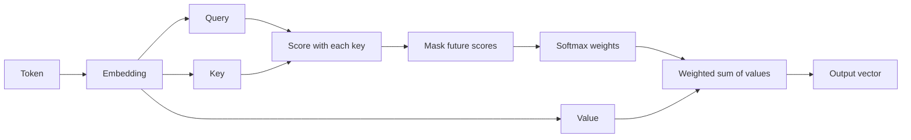

# Worked example: attention in a transformer

This example shows the same idea at each rung. The numbers are illustrative; the mechanism is the point.

## Claim ledger

| Claim | Anchor | Type |
| --- | --- | --- |
| A token is represented by a vector. | Model input embedding | Fact |
| Each token produces a query, a key, and a value through learned projections. | Attention layer | Fact |
| A query is compared with keys to produce scores. | Scaled dot-product attention | Fact |
| Softmax turns scores into weights that sum to one. | Attention definition | Fact |
| The output is a weighted sum of values. | Attention definition | Fact |
| A causal mask prevents a decoder from attending to future tokens. | Decoder attention | Fact |
| Multiple heads learn different relations in parallel. | Multi-head attention | Fact |

Simplifications: this ignores positional encoding, residual connections, layer normalization, training, and the rest of the network. The 4-token example is illustrative.

## Rung 1: STE-lite prose

**English**

> A transformer reads a sequence of tokens. First, the model turns each token into a vector. Then each token produces three vectors: a query, a key, and a value. The model compares the query of one token with the keys of the other tokens. The comparison gives a score for each pair. A softmax turns the scores into weights. The weights sum to one. The model multiplies each value by its weight, then adds the results. This weighted sum is the output for that token. In a decoder, a causal mask sets the scores of future tokens to negative infinity before the softmax. This step prevents the model from using future information. Multiple heads repeat this process with different learned projections. The model concatenates the head outputs and projects them again.

**Chinese**

> Transformer 先处理一串 token。模型把每个 token 变成一个向量。每个 token 再生成三个向量：query、key 和 value。模型用当前 token 的 query 与其他 token 的 key 做比较，得到一组分数。softmax 把分数变成权重，权重之和为 1。模型用权重对 value 加权求和，得到当前 token 的输出。在 decoder 中，causal mask 会把未来 token 的分数设为负无穷，因此模型不能看到未来。多头注意力用不同的投影重复这一过程，再把结果拼接起来。

Notice: one term per concept, short sentences, no metaphors, and no claims beyond the ledger.

## Rung 2: Diagram

Caption: This diagram shows how one token's query selects information from a set of values. The key path is query -> score -> softmax -> weighted sum. The diagram omits positional encoding, residual connections, and multi-head concatenation. The mask is shown on the main path; in a non-causal encoder, remove it.

A better first view would use four concrete tokens (for example, "The", "cat", "sat", "down") and show one query token with four weights. Put the generic pipeline in a second layer.

## Rung 3: Interactive HTML

Page outline:

1. **Thesis:** Each token uses a query to decide which other tokens to read.
2. **Concrete case:** Four tokens with fixed, illustrative attention weights. Hover or focus a token to see its query and the weights it assigns.
3. **Mechanism stepper:** Embed -> project to Q/K/V -> score -> mask -> softmax -> weighted sum -> output.
4. **One variable:** A toggle for causal mask on/off. Show the weight matrix and the tokens each position can read. Keep the layout fixed.
5. **Boundaries:** The toy weights are not learned; the diagram omits multi-head concatenation and positional encoding; attention is not the same as explanation.
6. **Check:** Why do the weights sum to one? What changes when the mask is on? Where does the analogy "reading" fail?

Use a matrix view and a token view side by side. The matrix should update when the mask changes. Do not animate particles moving between tokens; use a stable highlight.

## Rung 4: Video storyboard

| Scene | Time | Narration | Visual | Label | Transition |
| --- | --- | --- | --- | --- | --- |
| 1 | 0:00-0:12 | "A transformer must decide which tokens matter to each token." | Four tokens appear in a row. | Tokens | Cut |
| 2 | 0:12-0:30 | "Each token becomes a vector. Then it produces a query, a key, and a value." | One token splits into three colored vectors. | Q, K, V | Morph |
| 3 | 0:30-0:55 | "The query meets every key. The scores become weights. The weights sum to one." | Score bars appear, then normalize. | Scores -> weights | Transform |
| 4 | 0:55-1:15 | "The output is a weighted sum of values. In a decoder, a mask hides the future." | Values combine; a mask covers future columns. | Weighted sum | Highlight |
| 5 | 1:15-1:30 | "Multiple heads repeat this with different projections. Attention routes information; it does not explain the model by itself." | Three heads run in parallel, then merge. | Heads | Pull back |

Narration length: about 190-210 words for 90 seconds, leaving room for pauses. The final line adds the boundary case.

## What changes across rungs

- The prose gives the complete mechanism in a portable form.
- The diagram makes the path visible but omits timing and learning.
- The HTML lets the reader change the mask and see the consequence.
- The video makes the sequence and the build-up intuitive.

Each rung keeps the same claim ledger. The higher rungs do not add new facts; they add a way to see the same facts.

## Knowledge film example: why caches help

A 40-second no-narration film. The audience reads one bottom caption and watches the sentence happen.

| ID | Time | Shot | Subject | Action | Caption | Small text | Takeaway |
| --- | --- | --- | --- | --- | --- | --- | --- |
| S01 | 0-6 | close | a notebook and a sticky note on a desk | a hand copies one line from the notebook to the note | A cache is a small, fast copy. | cache = fast copy | the note is a copy |
| S02 | 6-14 | medium | the same desk, with the note closer to the hand | the hand reaches the note in one beat; the notebook takes three beats | Reading the note is faster. | 1 beat vs 3 beats | copies reduce access time |
| S03 | 14-24 | close | the notebook line changes; the note stays old | the hand picks up the note and frowns | But the copy can be stale. | stale | speed has a consistency cost |
| S04 | 24-32 | medium | the note and the notebook side by side | the hand checks the note first, then falls back to the notebook | Check the copy, then the source. | check -> fallback | the cache is a policy, not just a copy |
| S05 | 32-40 | wide | the desk pulls back; the note and notebook remain | the note is highlighted, then the notebook | That is a cache: speed now, consistency later. | speed / consistency | the trade-off is the idea |

Notes:

- The first 6 seconds show the copy happening; the definition comes after.
- S03 is the boundary; it is not a new metaphor.
- S05 returns to the opening image.
- The numbers "1 beat vs 3 beats" are illustrative; label them as illustrative if shown on screen.
- No narration. The captions carry the argument; the visuals carry the evidence.

This example follows the `knowledge-film` method in `references/knowledge-film.md`, adapted from `vibe-knowledge-film` (MIT).

